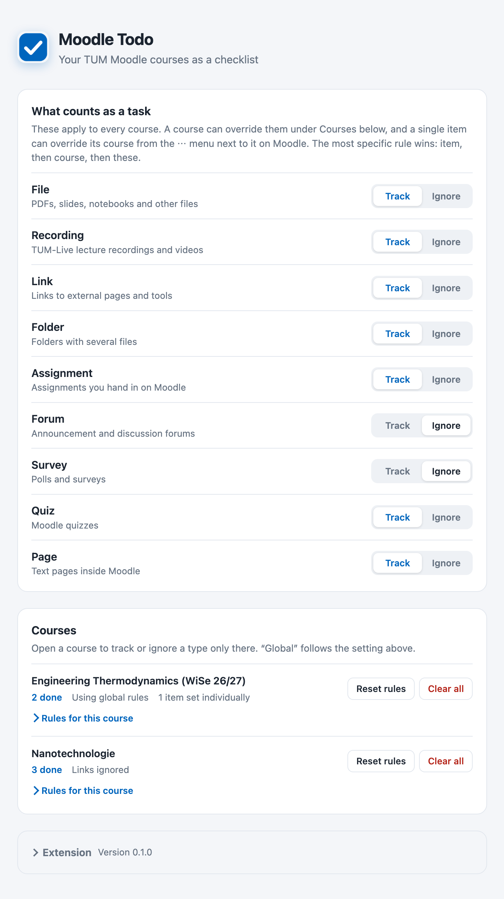

# Moodle Todo

A Chrome extension that turns your Moodle course pages into a todo list. Every lecture file, recording and problem sheet gets a checkbox, and you see how far you are in each week and in the whole course. Things that are not work, like announcement forums, can be ignored so they don't count.

Built for TUM Moodle (https://www.moodle.tum.de). Other Moodle sites work with a small change, see [Use it with another Moodle](#use-it-with-another-moodle).


## Install

1. Download **`moodle-todo-chrome.zip`** from the [latest release](../../releases/latest) and unzip it. You get a folder.
2. Open `chrome://extensions` in Chrome.
3. Turn on **Developer mode** (top right).
4. Click **Load unpacked** and select the unzipped folder.
5. Optional: pin the extension via the puzzle icon in the toolbar.

Keep the folder where it is. Chrome loads the extension from it, so deleting or moving the folder removes the extension.

To update, download the new zip, replace the folder's contents and click the reload icon on Moodle Todo in `chrome://extensions`.

## Use it

Open any course on Moodle.

- **Check off** an item with the checkbox in front of it. Done items are struck through.
- **Progress** is shown at the top of the course, as a badge on each week, and as a thin line under each tab in courses that use tabs.
- **Ignore** things that aren't tasks: hover an item, click **⋯** on the right and choose to ignore just this item, all items of that type in this course, or that type everywhere. Ignored items keep their normal look but have no checkbox and don't count.


## Settings

Click the extension icon to open the settings.

- **What counts as a task** decides per type (File, Recording, Link, Forum, …) whether it is tracked in every course. Forums and surveys are ignored by default.
- **Courses** lists your courses. Open **Rules for this course** to track or ignore a type only in that course. "Global" follows the setting above.
- **Reset rules** removes a course's rules but keeps your checkmarks. **Clear all** also deletes the checkmarks.

The most specific rule wins: a single item beats its course, and a course beats the global setting.



Your checkmarks are saved in Chrome and sync to other computers where you are signed in to Chrome. Removing the extension deletes them.

## Use it with another Moodle

The extension only runs on `www.moodle.tum.de`. To use it with your university's Moodle you need to build it yourself, which takes a few minutes and needs [Node.js](https://nodejs.org) 20 or newer.

1. Download this repository (green **Code** button, then **Download ZIP**) and unzip it.
2. Open `entrypoints/moodle.content.ts` and replace `https://www.moodle.tum.de` in both lines with your Moodle's address, for example `https://moodle.example-university.edu`.
3. In a terminal, inside the folder, run:

   ```sh
   npm install
   npm run build
   ```

4. Load the folder `dist/moodle-todo` in Chrome as described in [Install](#install).

It is tested on Moodle 4.x course pages in the weekly, topics and "onetopic" (tabs) formats. If your Moodle looks very different, checkboxes might not appear.
