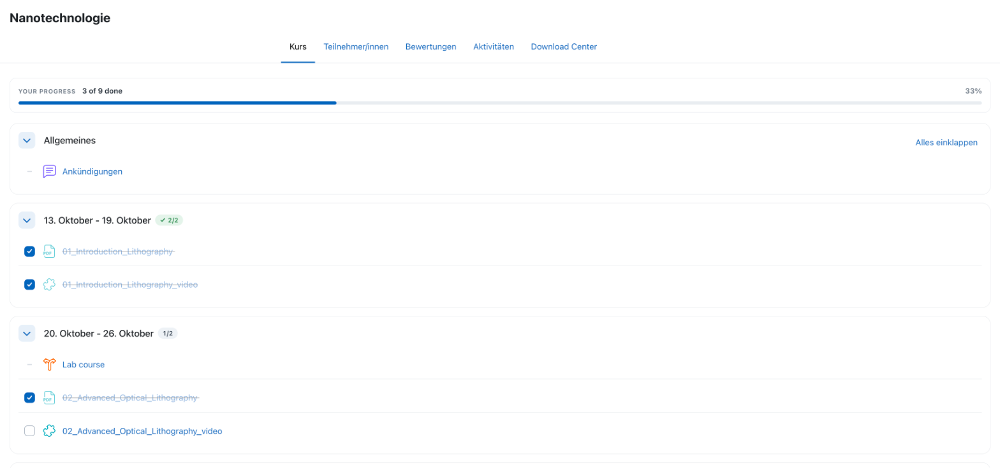
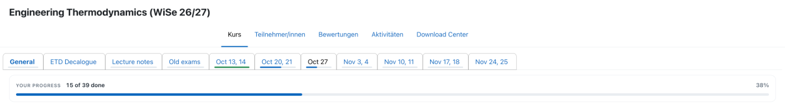
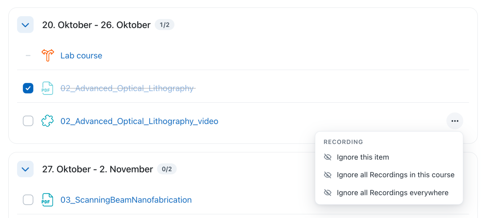
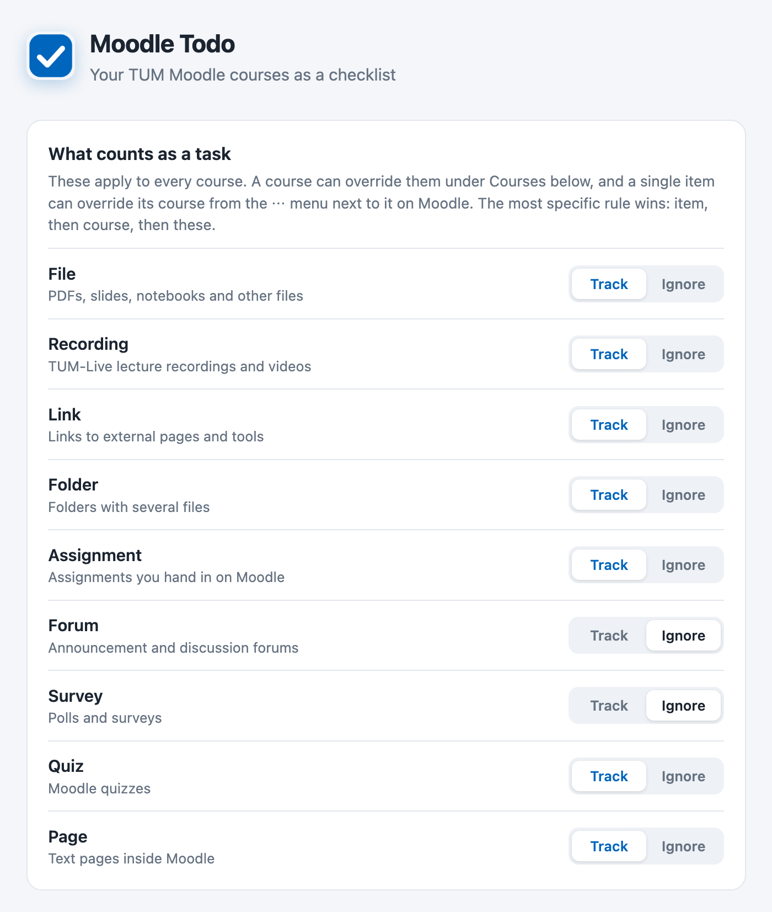
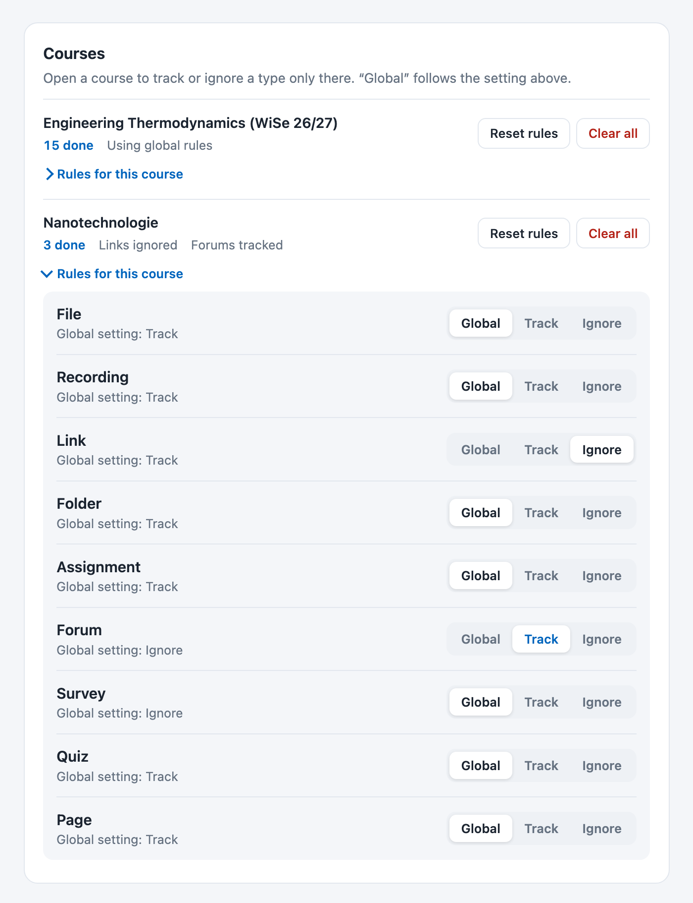

<div align="center">


# Moodle Todo

**Your Moodle courses as a checklist.**

Check off lectures, recordings and problem sheets right on the course page,<br>
and see how far you are in every week and every course.


[**Download**](../../releases/latest) · [Install](#install) · [How to use](#how-to-use) · [Settings](#settings) · [Other Moodle sites](#use-it-with-another-moodle)

<br>



</div>

<br>

## What you get

| | |
|---|---|
| **A checkbox on every item** | Files, recordings, links and assignments can be ticked off. Done items are struck through. |
| **Progress everywhere** | A bar for the whole course, a badge on each week, and a thin line under each tab. |
| **Ignore what isn't work** | Announcement forums and surveys don't count. Ignore anything else per item, per course or everywhere. |
| **Synced** | Your checkmarks follow you to every computer where you are signed in to Chrome. |
| **No tracking** | The extension only runs on Moodle, has no server of its own and only stores what you ticked, in Chrome's own storage. |

## Install

1. Download **`moodle-todo-chrome.zip`** from the [latest release](../../releases/latest) and unzip it. You get a folder.
2. Open `chrome://extensions` in Chrome.
3. Turn on **Developer mode** (top right).
4. Click **Load unpacked** and select the unzipped folder.
5. Optional: pin the extension via the puzzle icon in the toolbar.

> [!IMPORTANT]
> Keep the folder where it is. Chrome loads the extension from it, so deleting or moving the folder removes the extension.

**Updating:** download the new zip, replace the folder's contents and click the reload icon on Moodle Todo in `chrome://extensions`. Your checkmarks and rules are kept.

## How to use

Open any course on Moodle.

- **Check off** an item with the checkbox in front of it.
- **See your progress** at the top of the course, on each week, and under each tab in courses that use tabs.
- **Ignore** things that aren't tasks: hover an item, click **⋯** on the right and choose what to ignore.

In courses that use tabs, each tab gets a thin progress line. Green means the tab is finished.

<div align="center">

</div>

<br>

The **⋯** menu on an item:

<div align="center">

</div>

<br>

The menu has three levels:

| Menu entry | What it does |
|---|---|
| **Ignore this item** | Only this one item stops counting. |
| **Ignore all … in this course** | Every item of that type in this course. |
| **Ignore all … everywhere** | Every item of that type in all courses. |

Ignored items keep their normal look. They just have no checkbox and don't count.

## Settings

Click the extension icon to open the settings.

<table>
<tr>
<td valign="top"></td>
<td valign="top"></td>
</tr>
<tr>
<td align="center"><sub>Rules for every course</sub></td>
<td align="center"><sub>Rules for one course</sub></td>
</tr>
</table>

<br>

- **What counts as a task** decides per type (File, Recording, Link, Forum, …) whether it is tracked in every course. Forums and surveys are ignored by default.
- **Courses** lists your courses. Open **Rules for this course** to track or ignore a type only in that course. "Global" follows the setting above.
- **Reset rules** removes a course's rules but keeps your checkmarks. **Clear all** also deletes the checkmarks.

> [!TIP]
> The most specific rule wins: a single item beats its course, and a course beats the global setting.

> [!NOTE]
> Removing the extension from Chrome deletes your checkmarks.

## Use it with another Moodle

The extension only runs on `www.moodle.tum.de`. To use it with your university's Moodle you need to build it yourself. That takes a few minutes and needs [Node.js](https://nodejs.org) 20 or newer.

1. Download this repository (green **Code** button, then **Download ZIP**) and unzip it.
2. Open `entrypoints/moodle.content.ts` and replace `https://www.moodle.tum.de` in both lines with your Moodle's address, for example `https://moodle.example-university.edu`.
3. In a terminal, inside the folder, run:

   ```sh
   npm install
   npm run build
   ```

4. Load the folder `dist/moodle-todo` in Chrome as described in [Install](#install).

It is tested on Moodle 4.x course pages in the weekly, topics and "onetopic" (tabs) formats. If your Moodle looks very different, checkboxes might not appear.
